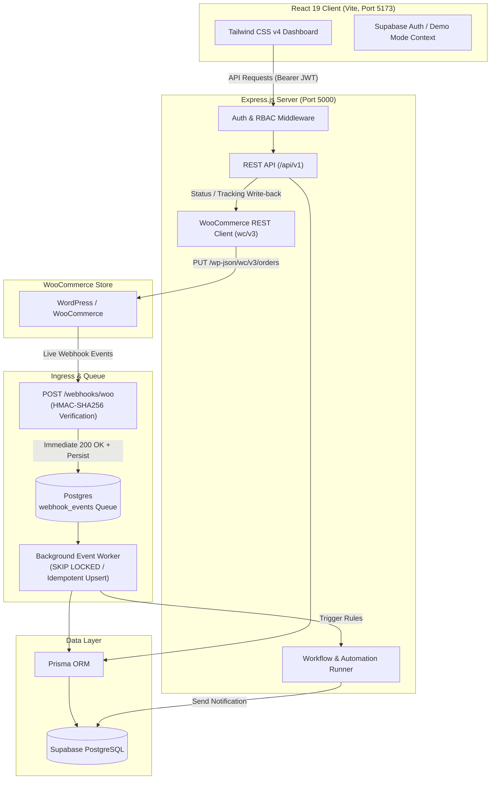

# WooCommerce CRM (woo-crm)

> A modern, bidirectional CRM purpose-built for WooCommerce stores. Unifies customer profiles, orchestrates live order workflows, manages customer communications, and synchronizes state seamlessly between WooCommerce and a dedicated operations dashboard.

[](#tech-stack)
[](#database--data-architecture)
[](#license)

---

## Table of Contents

- [Overview](#overview)
- [Key Features](#key-features)
- [System Architecture](#system-architecture)
- [Tech Stack](#tech-stack)
- [Directory Structure](#directory-structure)
- [Getting Started](#getting-started)
  - [Prerequisites](#prerequisites)
  - [1. Clone and Install Dependencies](#1-clone-and-install-dependencies)
  - [2. Environment Configuration](#2-environment-configuration)
  - [3. Database Setup & Seeding](#3-database-setup--seeding)
  - [4. Running the Application](#4-running-the-application)
  - [5. (Optional) Local WooCommerce Sandbox via Docker](#5-optional-local-woocommerce-sandbox-via-docker)
- [Authentication & Roles (RBAC)](#authentication--roles-rbac)
- [API Overview](#api-overview)
- [WooCommerce Webhooks & Real-time Ingestion](#woocommerce-webhooks--real-time-ingestion)
- [Documentation Reference](#documentation-reference)

---

## Overview

Small and mid-size e-commerce stores often struggle with fragmented customer and order histories that reside solely within WordPress admin screens. Support and sales agents lack a unified Customer 360 view, cannot follow an order lifecycle from payment to delivery in one place, and manually dispatch customer emails or miss follow-ups entirely.

**WooCommerce CRM** solves this with a purpose-built, high-performance architecture:
- **Bi-directional Synchronization:** Ingests live orders and customer updates via cryptographically signed webhooks and writes back status updates and carrier tracking directly into WooCommerce via the REST API (`wc/v3`).
- **Resilient & Idempotent Processing:** Webhooks are verified with HMAC-SHA256, queued in PostgreSQL, and processed asynchronously with deduplication and exponential backoff.
- **Unified Customer 360:** Instant lookup of order history, lifetime value (LTV), communication timeline, agent notes, and segment tags.
- **Workflow Automation Engine:** Trigger customizable notifications (order confirmations, shipping alerts, review requests, win-back campaigns) based on order lifecycle events.
- **Role-Based Access Control (RBAC):** Distinct permissions and UI views for Store Admins and Support/Sales Agents.

---

## Key Features

| Feature | Description |
|---|---|
| **Customer 360 View** | Aggregated customer profiles displaying lifetime spend, order count, average order value (AOV), contact info, notes, and activity timeline. |
| **Order Command Center** | Filterable order management with status workflow changes (Pending, Processing, Completed, Refunded, Cancelled), tracking number assignments, and line-item details. |
| **Bi-directional Sync** | Two-tier sync architecture supporting both real-time webhook ingestion and scheduled/manual full-store REST backfills. |
| **Workflow Automations** | Event-driven automation engine executing rules on events like `order.created`, `order.completed`, and `customer.created` with dynamic templating. |
| **Message Center** | Multi-channel message templates (email notifications) with delivery status logs and marketing opt-in compliance enforcement. |
| **Sync Audit Logs** | Visual inspection of webhook deliveries, payload inspection, queue worker health, and retry statuses. |
| **Enterprise RBAC** | Fine-grained permissions separating Admin configuration from Agent operations, backed by Supabase Auth and JWT verification. |
| **Instant Demo Mode** | One-click evaluator login (Admin or Agent) allowing frictionless evaluation without requiring external API keys. |

---

## System Architecture



---

## Tech Stack

### Frontend
- **Framework:** [React 19](https://react.dev/) + [Vite](https://vitejs.dev/)
- **Routing:** [React Router v7](https://reactrouter.com/)
- **Styling:** [Tailwind CSS v4](https://tailwindcss.com/)
- **Icons:** [Lucide React](https://lucide.dev/)
- **Auth Client:** [@supabase/supabase-js](https://supabase.com/docs/reference/javascript)

### Backend
- **Runtime:** [Node.js](https://nodejs.org/) (v18+) & [Express 5](https://expressjs.com/)
- **Database & ORM:** [PostgreSQL](https://www.postgresql.org/) (via [Supabase](https://supabase.com/)) with [Prisma ORM 6](https://www.prisma.io/)
- **Integration:** [@woocommerce/woocommerce-rest-api](https://www.npmjs.com/package/@woocommerce/woocommerce-rest-api)
- **Background Tasks:** Asynchronous queue processing with `FOR UPDATE SKIP LOCKED` and [node-cron](https://www.npmjs.com/package/node-cron)
- **Validation & Security:** [Zod](https://zod.dev/), HMAC-SHA256 constant-time verification, raw buffer retention for webhooks

---

## Directory Structure

```text
crm/
├── client/                      # React frontend application
│   ├── src/
│   │   ├── api/                 # API client & fetch wrappers
│   │   ├── auth/                # Supabase Auth provider & ProtectedRoute
│   │   ├── components/          # Reusable UI components & AppShell layout
│   │   ├── pages/               # Dashboard, Customers, Orders, Workflows, Sync, Settings
│   │   ├── App.jsx              # Application router & route definitions
│   │   └── main.jsx             # Entry point
│   ├── package.json
│   └── vite.config.js
│
├── server/                      # Express.js backend application
│   ├── prisma/
│   │   ├── schema.prisma        # Prisma database schema definition
│   │   ├── seed.js              # Database seeder (templates, workflows, demo records)
│   │   ├── supabase-setup.sql   # Supabase RLS policies and SQL triggers
│   │   └── migrations/          # Version-controlled database migrations
│   ├── src/
│   │   ├── config/              # Environment, Woo client, and Supabase config
│   │   ├── jobs/                # Scheduled background cron triggers
│   │   ├── middleware/          # Auth JWT, RBAC guards, errors, webhook HMAC
│   │   ├── routes/              # Express API route modules
│   │   ├── utils/               # Logger, HMAC verification, email sender
│   │   ├── workers/             # SKIP LOCKED webhook queue event processor
│   │   ├── app.js               # Express application configuration
│   │   └── index.js             # Server listener & worker bootstrap
│   └── package.json
│
├── docker-compose.yml           # Local WordPress + WooCommerce + MySQL sandbox
├── docs/                        # Deep-dive architecture and design documentation
│   ├── PRD.md                   # Product Requirements Document
│   ├── Database.md              # Database schema, RLS, & idempotency patterns
│   ├── Design.md                # System design & UI/UX architecture
│   └── WooCommerce_Integration.md # Webhook, HMAC, & REST client specification
└── README.md                    # Project documentation (this file)
```

---

## Getting Started

### Prerequisites

- **Node.js** >= 18.0.0
- **npm** >= 9.0.0
- **PostgreSQL** database (a free [Supabase](https://supabase.com) project or local PostgreSQL instance)
- *(Optional)* **Docker & Docker Compose** (for running a local WordPress/WooCommerce sandbox)

---

### 1. Clone and Install Dependencies

```bash
# Clone the repository
git clone <repository-url>
cd crm

# Install server dependencies
cd server
npm install

# Install client dependencies
cd ../client
npm install
```

---

### 2. Environment Configuration

#### Backend (`server/.env`)
Create `server/.env` with the following variables:

```env
PORT=5000
NODE_ENV=development

# Database Connection (Supabase / Postgres)
DATABASE_URL="postgresql://postgres:[YOUR-PASSWORD]@[YOUR-HOST]:5432/postgres?sslmode=require"

# Supabase Credentials
SUPABASE_URL="https://[YOUR-PROJECT].supabase.co"
SUPABASE_ANON_KEY="your-supabase-anon-key"
SUPABASE_SERVICE_ROLE_KEY="your-supabase-service-role-key"

# WooCommerce API Credentials (Optional for local testing / Demo mode)
WOO_STORE_URL="http://localhost:8080"
WOO_CONSUMER_KEY="ck_your_consumer_key"
WOO_CONSUMER_SECRET="cs_your_consumer_secret"
WOO_WEBHOOK_SECRET="your_webhook_hmac_secret"

# SMTP Settings (Optional for emails)
SMTP_HOST="sandbox.smtp.mailtrap.io"
SMTP_PORT=2525
SMTP_USER="your-smtp-user"
SMTP_PASS="your-smtp-password"
EMAIL_FROM="orders@yourstore.com"
```

#### Frontend (`client/.env`)
Create `client/.env` with the following variables:

```env
VITE_API_BASE_URL="http://localhost:5000/api"
VITE_SUPABASE_URL="https://[YOUR-PROJECT].supabase.co"
VITE_SUPABASE_ANON_KEY="your-supabase-anon-key"
```

---

### 3. Database Setup & Seeding

Run Prisma migrations and populate starter workflows, email templates, and sample records:

```bash
cd server

# Generate Prisma Client
npm run db:generate

# Run migrations against your database
npm run db:migrate

# Seed message templates, starter workflows, and demo data
npm run db:seed
```

*(Optional)* Launch Prisma Studio to visually inspect tables:
```bash
npm run db:studio
```

---

### 4. Running the Application

In development, start both the backend server and frontend client concurrently:

#### Terminal 1: Backend Server
```bash
cd server
npm run dev
# Starts Express server on http://localhost:5000
# Automatically boots background event worker & cron jobs
```

#### Terminal 2: Frontend Client
```bash
cd client
npm run dev
# Starts Vite dev server on http://localhost:5173
```

Visit **`http://localhost:5173`** in your browser.

---

### 5. (Optional) Local WooCommerce Sandbox via Docker

To spin up a local WordPress + WooCommerce environment alongside a MySQL 8 container:

```bash
# In the project root:
docker-compose up -d
```

- **WordPress / Store URL:** `http://localhost:8080`
- **Database Port:** `3306` (`wpuser` / `wppassword`)
- Configure WooCommerce in WordPress Admin (`/wp-admin`), enable REST API keys under **WooCommerce > Settings > Advanced > REST API**, and configure Webhooks pointing to your CRM backend (`http://host.docker.internal:5000/webhooks/woo`).

---

## Authentication & Roles (RBAC)

The application implements strict Role-Based Access Control:

| Feature / Action | Admin | Agent |
|---|:---:|:---:|
| View Dashboard & Analytics | :white_check_mark: | :white_check_mark: |
| View Customer 360 & Profiles | :white_check_mark: | :white_check_mark: |
| Add Customer Notes & Tags | :white_check_mark: | :white_check_mark: |
| View Order History & Details | :white_check_mark: | :white_check_mark: |
| Update Order Status & Tracking | :white_check_mark: | :white_check_mark: |
| Manual Sync / Re-trigger Ingestion | :white_check_mark: | :white_check_mark: |
| Create / Edit / Delete Workflows | :white_check_mark: | :x: |
| Manage Message Templates | :white_check_mark: | :x: |
| Store & API Integration Settings | :white_check_mark: | :x: |

### Quick Demo Mode Evaluation
If testing without active Supabase credentials or internet access, click either **Quick Demo: Admin** or **Quick Demo: Agent** on the login page (`/login`) for instantaneous access with complete RBAC simulation.

---

## API Overview

All protected endpoints require a Bearer JWT: `Authorization: Bearer <token>`.

### Ingestion & Webhooks
- `POST /webhooks/woo` - Ingests cryptographically signed WooCommerce webhooks (`X-WC-Webhook-Signature`).
- `GET /health` - Health check and system uptime.

### Customers
- `GET /api/v1/customers` - List customers with search, pagination, and sorting.
- `GET /api/v1/customers/:id` - Full Customer 360 profile with order history, metrics, and notes.
- `POST /api/v1/customers/:id/notes` - Add internal agent note to customer profile.
- `PUT /api/v1/customers/:id/tags` - Update customer segmentation tags.

### Orders
- `GET /api/v1/orders` - Filter orders by status, date, or customer.
- `GET /api/v1/orders/:id` - Order line items, billing, shipping, and history.
- `PATCH /api/v1/orders/:id/status` - Update status and write back to WooCommerce.
- `PATCH /api/v1/orders/:id/tracking` - Update shipping carrier & tracking code.

### Workflows & Automations
- `GET /api/v1/workflows` - List automated workflows and run metrics.
- `POST /api/v1/workflows` - Create a new automation rule *(Admin only)*.
- `PATCH /api/v1/workflows/:id/toggle` - Enable or pause workflow *(Admin only)*.

### Sync & Auditing
- `GET /api/v1/sync/status` - Ingestion queue count, dead-letter stats, and last sync timestamp.
- `POST /api/v1/sync/backfill` - Trigger asynchronous backfill of customers/orders via WooCommerce REST API.

---

## WooCommerce Webhooks & Real-time Ingestion

The CRM guarantees reliable event consumption:
1. **Raw Body Retention:** Express preserves the untouched request buffer (`req.rawBody`) before parsing JSON.
2. **HMAC-SHA256 Signature Verification:** Verified against `X-WC-Webhook-Signature` using `crypto.timingSafeEqual` to avoid timing attacks.
3. **Idempotent Storage:** Deliveries are deduplicated on `X-WC-Webhook-Delivery-ID` in the `webhook_events` table.
4. **Immediate Acknowledgment:** The endpoint immediately returns `200 OK` to WooCommerce.
5. **Decoupled Worker:** The background worker polls using `SELECT ... FOR UPDATE SKIP LOCKED` and recalculates aggregates without race conditions.

---

## Documentation Reference

For in-depth architectural specifications and implementation guides, see the `docs/` folder:

- [`docs/PRD.md`](docs/PRD.md) - Product Requirements Document and feature matrix.
- [`docs/Database.md`](docs/Database.md) - Database schema, Prisma models, RLS policies, and idempotency guarantees.
- [`docs/Design.md`](docs/Design.md) - System architecture, UI design system, and component contracts.
- [`docs/WooCommerce_Integration.md`](docs/WooCommerce_Integration.md) - Webhook verification, REST API client, and retry mechanisms.

---

## License

This project is licensed under the [ISC License](server/package.json).
