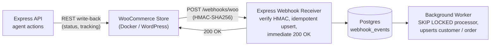

# WooCommerce Integration Reference: Architecture, Data Fetching & Implementation

| Field | Value |
|---|---|
| **Project** | woo-crm |
| **Document target** | `docs/WooCommerce_Integration.md` |
| **Integration style** | Two-tier hybrid (signed webhook ingestion + REST API client) |
| **Key standards** | HMAC-SHA256 verification, idempotent DB queuing (`FOR UPDATE SKIP LOCKED`), optimistic concurrency |
| **Related docs** | [PRD.md](./PRD.md), [database.md](./database.md), [design.md](./design.md) |

---

## 1. System Architecture Overview

The CRM synchronizes with WooCommerce using an **asynchronous, event-driven hybrid model**:

1. **Ingress (realtime push via webhooks).** WooCommerce emits cryptographically signed HMAC webhooks for live order and customer updates. The CRM validates the signature against the raw body, idempotently saves the event into a PostgreSQL queue table (`webhook_events`), and immediately returns `200 OK`.
2. **Egress and backfills (REST API client).** The CRM initializes the `@woocommerce/woocommerce-rest-api` client for bi-directional write-backs (for example updating order status, carrier and tracking number) and historical backfills.



---

## 2. Implementation Map (Files & Components)

| Component | File path | Function / responsibility |
|---|---|---|
| **REST API client** | `server/src/config/woo.js` | Exports `getWooClient()`, initializing `@woocommerce/woocommerce-rest-api` (version `wc/v3`). |
| **HMAC verifier** | `server/src/utils/hmac.js` | Exports `verifyWooWebhookSignature()` using `crypto.createHmac("sha256", secret)` and `timingSafeEqual`. |
| **Webhook middleware** | `server/src/middleware/wooWebhook.js` | Extracts `x-wc-webhook-*` headers and rejects unsigned or malformed requests with `401 Unauthorized`. |
| **Webhook ingestion route** | `server/src/routes/webhooks.js` | `POST /webhooks/woo`: performs an idempotent `upsert` on `deliveryId` in Prisma. |
| **Raw buffer interceptor** | `server/src/app.js` | Captures the `req.rawBody` buffer in `express.json()` before JSON deserialization so HMAC checksums remain intact. |
| **Environment config** | `server/src/config/env.js` | Manages store URL, consumer key, consumer secret and webhook secret from `.env`. |
| **Database models** | `server/prisma/schema.prisma` | Defines `WebhookEvent`, `Customer.wooCustomerId`, `Order.wooOrderId` and `SyncState`. |
| **Local store environment** | `docker-compose.yml` | WordPress 6.x + MySQL 8.0 on `http://localhost:8080`. |

---

## 3. Data Ingestion Pipeline (Step by Step)

### Step 3.1: Raw body preservation (`server/src/app.js`)

HMAC signatures cannot be validated against a re-serialized JavaScript object. The raw buffer must be captured at the HTTP stream layer:

```javascript
app.use(express.json({
  verify: (req, res, buf) => {
    req.rawBody = buf;
  },
}));
```

### Step 3.2: Cryptographic signature verification (`server/src/utils/hmac.js`)

WooCommerce sends a Base64-encoded SHA256 digest in `x-wc-webhook-signature`. The CRM computes the digest over the raw body and performs a constant-time comparison to prevent timing attacks:

```javascript
function verifyWooWebhookSignature(rawBody, signature, secret) {
  if (!rawBody || !signature || !secret) return false;
  const hash = crypto.createHmac("sha256", secret).update(rawBody).digest("base64");
  try {
    return crypto.timingSafeEqual(Buffer.from(hash), Buffer.from(signature));
  } catch {
    return false; // timingSafeEqual throws when the lengths differ
  }
}
```

### Step 3.3: Idempotent event staging (`server/src/routes/webhooks.js`)

WooCommerce retries webhooks automatically on network timeouts, which risks duplicate writes. The ingestion route uses `deliveryId` as a unique database constraint:

```javascript
router.post("/woo", wooWebhookMiddleware, async (req, res, next) => {
  const { deliveryId, topic, resourceId } = req.webhookMeta;
  const payload = req.body;
  try {
    await prisma.webhookEvent.upsert({
      where: { deliveryId },
      create: {
        deliveryId,
        topic,
        wooResourceId: resourceId ? parseInt(resourceId, 10) : null,
        payload,
      },
      update: {}, // deduplication: a duplicate delivery is a no-op
    });
    return res.status(200).json({ received: true });
  } catch (err) {
    next(err);
  }
});
```

---

## 4. REST API Client & Write-Backs (`server/src/config/woo.js`)

The CRM does not rely solely on inbound webhooks. It keeps an active REST client for administrative mutations:

```javascript
const WooCommerceRestApi = require("@woocommerce/woocommerce-rest-api").default;
const env = require("./env");

function getWooClient() {
  if (!env.woo.storeUrl || !env.woo.consumerKey || !env.woo.consumerSecret) {
    throw new Error("WooCommerce credentials not configured.");
  }
  return new WooCommerceRestApi({
    url: env.woo.storeUrl,
    consumerKey: env.woo.consumerKey,
    consumerSecret: env.woo.consumerSecret,
    version: "wc/v3",
    queryStringAuth: true,
  });
}
```

### Write-back use cases

- **Fulfillment tracking.** When a CRM agent enters a tracking number or shipping carrier, the CRM updates WooCommerce via `PUT /wp-json/wc/v3/orders/{id}`.
- **Order status synchronization.** Moving an order from Processing to Completed inside the CRM triggers a write-back to WooCommerce.

### Write-back loop prevention

1. The CRM records `orders.last_crm_push_at = now()`.
2. When the resulting echo webhook arrives from WooCommerce, the worker compares the order's `status` and `tracking_number` against the current database values.
3. If they are identical, side effects (such as automated customer emails) are skipped.

---

## 5. Database Schema & Concurrency Control

### Prisma models (`server/prisma/schema.prisma`)

- **`WebhookEvent`**: persistent queue holding inbound payloads (status: `pending`, `processing`, `done`, `failed`).
- **`Customer`**
  - `wooCustomerId`: unique integer mapped to the WooCommerce user ID.
  - `totalSpent`, `orderCount`, `lastOrderAt`: recomputed aggregate columns.
  - `wooModifiedAt`: timestamp used to prevent stale writes.
- **`Order`**
  - `wooOrderId`: unique integer mapped to the WooCommerce post ID.
  - `number`: human-readable reference (for example `5281`).
  - `lineItems`, `refunds`: JSON storage matching the upstream WooCommerce payload.
- **`OrderEvent`**: audit trail of status transitions, explicitly capturing `source: "woo" | "crm"`.

The full schema is in [database.md](./database.md).

### Stale-data guard (optimistic concurrency)

Delayed or out-of-order webhook deliveries must not overwrite newer records, so upserts enforce a timestamp comparison:

```sql
INSERT INTO orders (woo_order_id, number, customer_id, status, total, line_items, woo_modified_at, updated_at)
VALUES ($1, $2, $3, $4, $5, $6::jsonb, $7, now())
ON CONFLICT (woo_order_id) DO UPDATE
   SET status = EXCLUDED.status,
       total = EXCLUDED.total,
       line_items = EXCLUDED.line_items,
       woo_modified_at = EXCLUDED.woo_modified_at,
       updated_at = now()
 WHERE orders.woo_modified_at < EXCLUDED.woo_modified_at;
```

This column list is abbreviated. [database.md](./database.md) section 8.3 has the full statement and the side effects to run in the same transaction.

---

## 6. Background Queue Worker Blueprint (`server/src/workers/eventProcessor.js`)

Events staged in `webhook_events` are processed asynchronously by a background loop using PostgreSQL row locking:

```javascript
// Worker claiming pattern using SKIP LOCKED
const events = await prisma.$queryRaw`
  UPDATE webhook_events
     SET status = 'processing',
         locked_at = now(),
         attempts = attempts + 1
   WHERE id IN (
     SELECT id FROM webhook_events
      WHERE status = 'pending' AND (next_attempt_at IS NULL OR next_attempt_at <= now())
      ORDER BY received_at ASC
      LIMIT 10
      FOR UPDATE SKIP LOCKED
   )
  RETURNING *;
`;
```

Success, retry with backoff, dead-letter and stale-lock recovery statements are in [database.md](./database.md) section 8.1.

---

## 7. Local Testing & Verification

1. **Start the local WooCommerce Docker stack:**

   ```bash
   docker-compose up -d
   ```

2. **Open WordPress and WooCommerce** at `http://localhost:8080`.
3. **Complete store setup.**
4. **Generate REST API keys** under **WooCommerce > Settings > Advanced > REST API**.
5. **Configure webhooks** (same Advanced settings area) to point to `http://host.docker.internal:5000/webhooks/woo`, using the webhook secret from your `.env`.